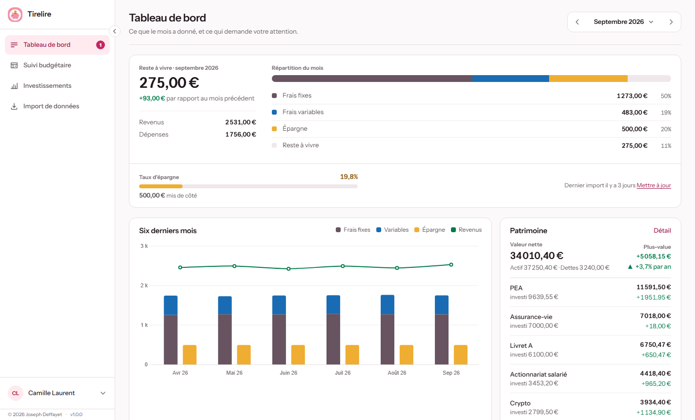
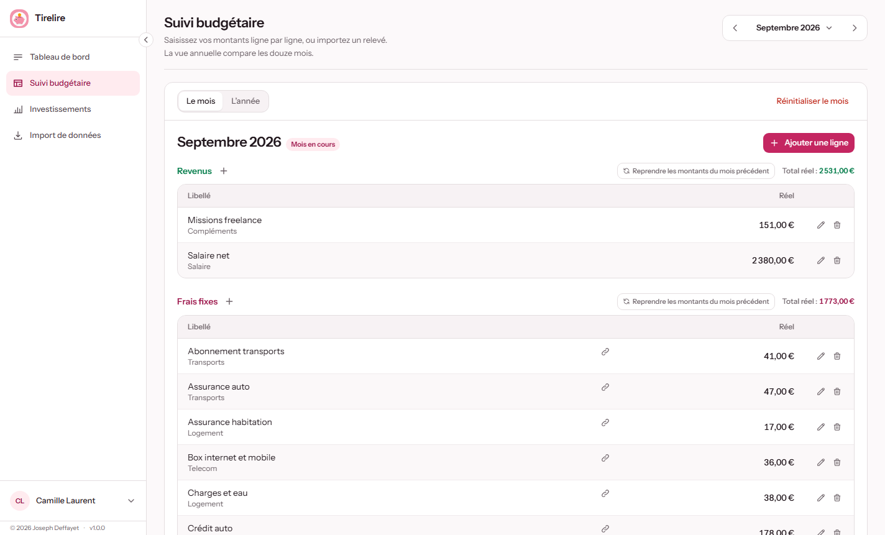
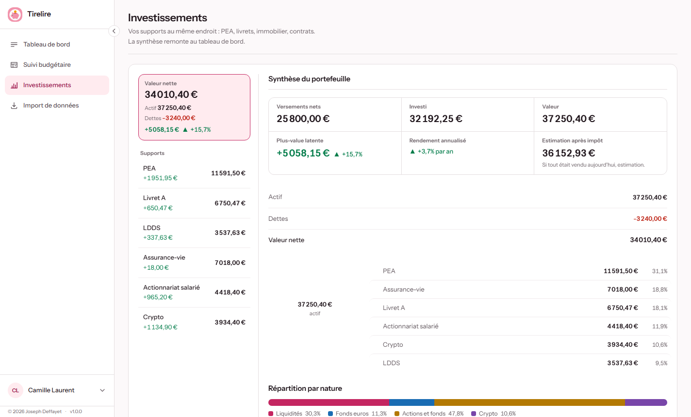
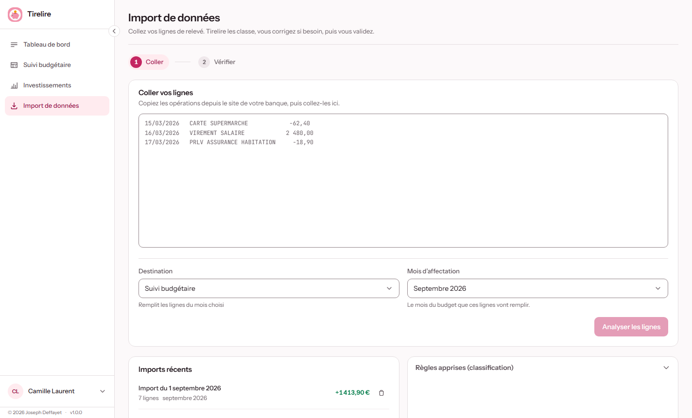
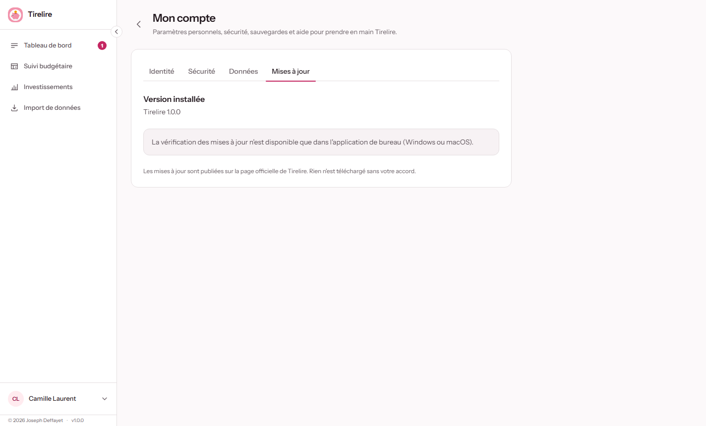

  

<h1 align="center">Tirelire</h1>

  Vos finances personnelles, sur votre ordinateur, et nulle part ailleurs. 
  Budget mensuel, investissements, import de relevés bancaires. Application de bureau Windows et macOS.

  <a href="https://github.com/Vitopya/tirelire_app/releases/latest"><strong>Télécharger la dernière version</strong></a>

---

Ce dépôt est le **point de distribution officiel** de Tirelire : installateurs, fichiers de mise à jour et documentation d'utilisation. Il ne contient pas le code source.

## Sommaire

- [Ce que fait Tirelire](#ce-que-fait-tirelire)
- [Aperçu](#aperçu)
- [Télécharger et installer](#télécharger-et-installer)
- [Premier lancement](#premier-lancement)
- [Mises à jour](#mises-à-jour)
- [Vos données](#vos-données)
- [Questions fréquentes](#questions-fréquentes)
- [Signaler un problème](#signaler-un-problème)
- [Licence](#licence)
- [English](#english)

## Ce que fait Tirelire

| | |
|---|---|
| **Tableau de bord** | Reste à vivre du mois, répartition entre frais fixes, frais variables et épargne, taux d'épargne. Six derniers mois en un graphique, patrimoine (valeur nette et plus-value par support), rappels du jour avec pastille sur l'icône de l'application. |
| **Suivi budgétaire** | Un tableau par mois, trois sections (revenus, frais fixes, frais variables). Reconduction du mois précédent en un clic, vue annuelle pour comparer les douze mois. |
| **Investissements** | PEA et actions, assurance-vie, crypto, immobilier et prêts, livrets réglementés, actionnariat salarié, placements à terme, supports personnalisés. Chaque support tient un journal d'opérations datées (versements, retraits, achats, ventes, dividendes). Synthèse : valeur nette (actif moins dettes), rendement annualisé, estimation après impôt, répartition par nature. |
| **Import de relevés** | Collez le texte d'un relevé bancaire : les opérations sont détectées, catégorisées et injectées dans le budget du mois. Tirelire mémorise vos corrections pour les imports suivants. |
| **Sauvegardes** | Export et import complets de vos données, avec mot de passe si vous le souhaitez. Export CSV. |

Tout fonctionne **hors ligne**. Aucun compte, aucun abonnement, aucune connexion bancaire.

## Aperçu

**Tableau de bord** : le mois d'un coup d'oeil.

**Suivi budgétaire** : vos lignes, mois par mois.

**Investissements** : tous vos supports au même endroit, avec la valeur nette du portefeuille.

**Import de données** : collez, vérifiez, validez.

**Thème sombre** disponible depuis le menu du compte.

Les captures utilisent des données fictives.

## Télécharger et installer

Rendez-vous sur la page de la [**dernière version**](https://github.com/Vitopya/tirelire_app/releases/latest), section **Assets**, et prenez le fichier qui correspond à votre système.

| Système | Fichier | Remarque |
|---|---|---|
| Windows 10 / 11 (64 bits) | `Tirelire-Setup-X.Y.Z.exe` | Installateur classique, choix du dossier possible |
| macOS Apple Silicon | `Tirelire-X.Y.Z-arm64.dmg` | Mac M1, M2, M3, M4 |
| macOS Intel | `Tirelire-X.Y.Z-x64.dmg` | Mac Intel |

Les autres fichiers de la page (`latest.yml`, `latest-mac.yml`, `.blockmap`, `.zip`) servent au mécanisme de mise à jour. Vous n'avez pas à les télécharger.

### Windows

1. Ouvrez `Tirelire-Setup-X.Y.Z.exe`.
2. Si **Windows SmartScreen** affiche « Windows a protégé votre ordinateur » : cliquez sur **Informations complémentaires**, puis **Exécuter quand même**. L'application n'est pas signée par un certificat commercial, ce qui déclenche cet avertissement.
3. Suivez l'assistant. Tirelire s'installe pour votre compte utilisateur, sans droits administrateur.
4. Lancez Tirelire depuis le menu Démarrer.

### macOS

1. Ouvrez le fichier `.dmg` et glissez **Tirelire** dans **Applications**.
2. À la première ouverture, macOS peut refuser de lancer l'application (« ne peut pas être ouverte car elle provient d'un développeur non identifié »). Deux solutions :
   - clic droit sur Tirelire dans Applications, **Ouvrir**, puis confirmer ;
   - ou **Réglages Système** > **Confidentialité et sécurité**, bouton **Ouvrir quand même** en bas de la page.
3. Cette manipulation n'est nécessaire qu'une fois.

### Mettre à jour une installation existante

Installez la nouvelle version par-dessus l'ancienne, sans désinstaller. Vos données sont conservées : elles ne sont pas dans le dossier de l'application.

**Vous avez une version 3.x ?** La numérotation est repartie de 1.0.0 le 4 septembre 2026, première version officielle. Une installation 3.x ne verra pas cette version dans ses mises à jour automatiques : téléchargez l'installateur ici et installez-le par-dessus, vos données sont conservées.

## Premier lancement

- Tirelire s'ouvre directement sur le **tableau de bord**, sans mot de passe. Les nouveautés de la version s'affichent une fois, puis une visite guidée présente les écrans. Pour relire les nouveautés, cliquez sur la mention de version en bas de la barre latérale.
- Le tableau est vide : commencez par **Suivi budgétaire** pour saisir vos revenus et charges du mois, ou par **Import de données** pour coller un relevé.
- Un **mot de passe** (optionnel) se définit dans **Mon compte** > **Sécurité**. Il protège l'ouverture de l'application. Un indice de rappel peut être enregistré avec lui.

## Mises à jour

Au lancement, Tirelire vérifie si une nouvelle version est publiée ici. Si c'est le cas :

- un **bandeau** apparaît en haut de l'application, avec un bouton **Mettre à jour**. Il se ferme d'une croix et revient au lancement suivant ;
- l'onglet **Mon compte** > **Mises à jour** affiche la version installée, les nouveautés de la version proposée et les actions disponibles.

Rien n'est téléchargé sans votre accord. Sur macOS, si l'installation automatique n'est pas possible, Tirelire vous renvoie vers cette page pour télécharger le fichier manuellement.

## Vos données

**Où sont-elles ?** Sur votre ordinateur, dans un fichier unique :

| Système | Emplacement |
|---|---|
| Windows | `%APPDATA%\finboard\data\finboard.db` |
| macOS | `~/Library/Application Support/finboard/data/finboard.db` |

**Sont-elles protégées ?** Le fichier est **chiffré** (SQLCipher, clé de 256 bits). La clé est générée au premier lancement et rangée dans le trousseau du système, DPAPI sous Windows, Keychain sous macOS. Elle est liée à votre session utilisateur : une personne qui copie le fichier sur une autre machine ou depuis un autre compte ne peut pas le lire.

**Ce que ça ne protège pas** : une session ouverte sur votre compte. Verrouillez votre session et, si l'ordinateur est partagé, définissez un mot de passe dans Tirelire.

**Sauvegardes** : **Mon compte** > **Données**. Exportez régulièrement, avec mot de passe si le fichier doit quitter votre machine. C'est aussi le seul moyen de récupérer vos données si le trousseau du système est réinitialisé, si vous changez d'ordinateur, ou si vous réinstallez le système.

**Réseau** : Tirelire ne contacte aucun serveur, sauf cette page GitHub pour vérifier les mises à jour. Aucune donnée n'en sort.

## Questions fréquentes

**Tirelire se connecte-t-elle à ma banque ?**
Non, et c'est volontaire. Vous collez le texte d'un relevé, Tirelire fait le tri. Aucun identifiant bancaire n'est saisi.

**Puis-je l'utiliser sur deux ordinateurs ?**
Oui, avec un export sur le premier et un import sur le second. Il n'y a pas de synchronisation automatique.

**J'ai oublié mon mot de passe.**
L'indice de rappel s'affiche sur l'écran de connexion. Sans lui, restaurez une sauvegarde : elle ne contient pas le mot de passe.

**Windows dit que l'application est dangereuse.**
C'est l'avertissement SmartScreen sur les applications sans certificat commercial. Vérifiez que vous avez téléchargé le fichier depuis cette page, puis **Informations complémentaires** > **Exécuter quand même**.

**L'application ne s'ouvre pas.**
Fermez toute instance déjà lancée, puis relancez. Sur Windows, consultez `%APPDATA%\finboard\finboard-electron.log` et joignez-le à votre signalement.

**Comment désinstaller ?**
Windows : Paramètres > Applications > Tirelire > Désinstaller. macOS : glissez Tirelire dans la corbeille. Dans les deux cas, le fichier de données est conservé ; supprimez le dossier indiqué plus haut pour tout effacer.

## Signaler un problème

- Bug ou suggestion : ouvrez une [issue](https://github.com/Vitopya/tirelire_app/issues) en indiquant votre système et la version (en bas de la barre latérale, ou dans **Mon compte** > **Mises à jour**).
- Faille de sécurité : voir [SECURITY.md](SECURITY.md). Pas de détails en public, merci.

## Licence

Tirelire est une création de **Joseph Deffayet**, product designer. Logiciel propriétaire, tous droits réservés : usage personnel, pas de redistribution ni d'usage commercial sans accord écrit. Conditions complètes dans [LICENSE](LICENSE).

## English

Tirelire is a personal finance desktop app for Windows and macOS: monthly budget, investments, bank statement import. Everything stays on your computer in an encrypted local file. No account, no cloud, no bank connection. This repository hosts the release binaries and user documentation; source code is not published here. Download the latest build from [Releases](https://github.com/Vitopya/tirelire_app/releases/latest). Copyright Joseph Deffayet, all rights reserved, see [LICENSE](LICENSE).
